# BinMate

**One product is not one piece of waste — and the right bin depends on where you're standing.**

A yogurt pot is a polystyrene pot, an aluminium lid and a cardboard sleeve. In most cities
those three parts go to three different places. Every "point your camera at rubbish" app
answers with a single bin, which is the wrong shape of answer to the wrong question.

BinMate scans a barcode, decomposes the product into its actual packaging components, and
resolves each component against the collection rules of one specific city.

---

## Screenshots

All captured from the running app — on an iPhone simulator and, where a wider frame
reads better, from the Mac Catalyst build of the same code.

| Home — iPhone | Camera unavailable, handled — iPhone |
|---|---|
| 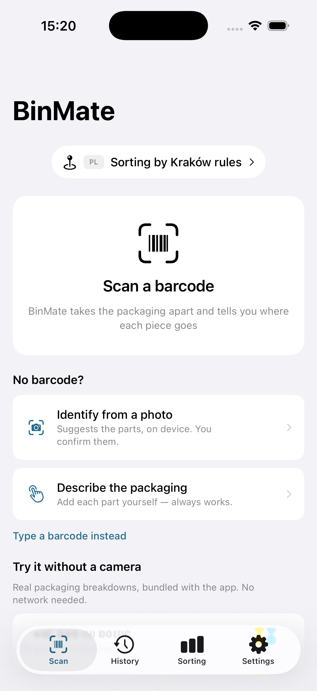 | 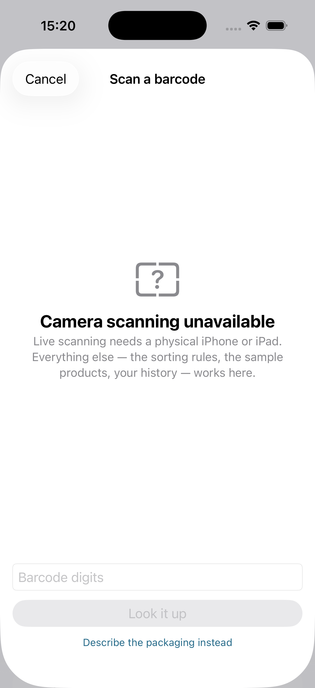 |

**The same bottle, three cities.** One tap switches between them, instantly and offline.

| Berlin | Kraków | Tokyo |
|---|---|---|
| 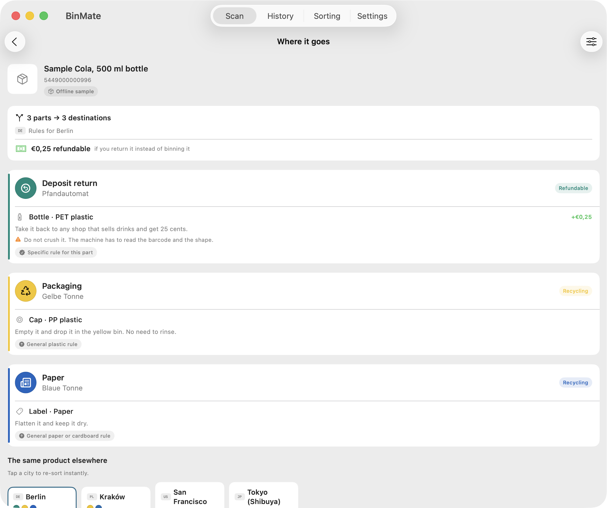 | 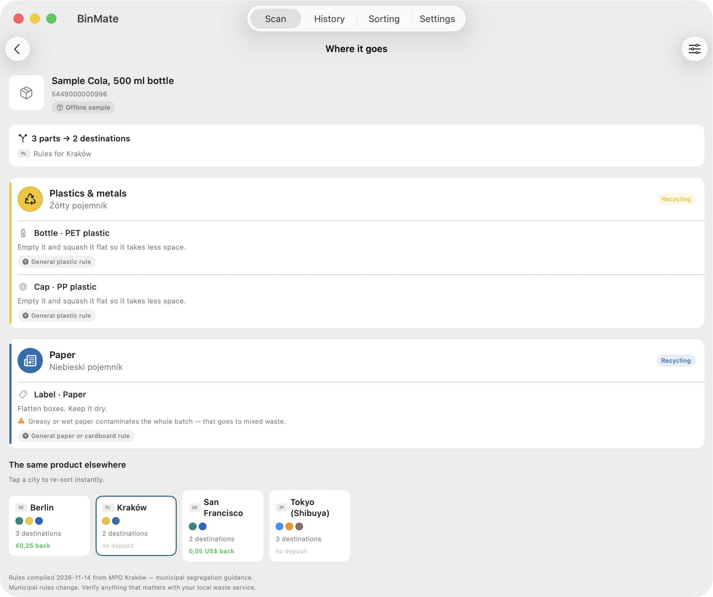 | 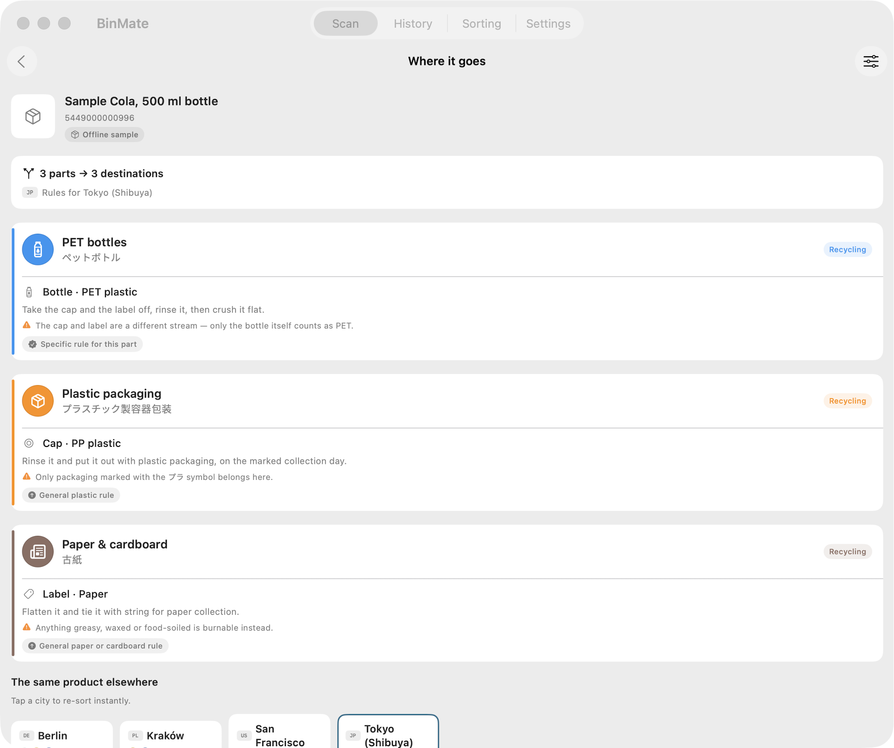 |
| *"**do not crush it** — the machine has to read the barcode"* · **+€0.25** | *"squash it flat"* · no deposit | *"take the cap **and the label** off"* · 3 separate streams |

| Photo identification | Where things went | History |
|---|---|---|
| 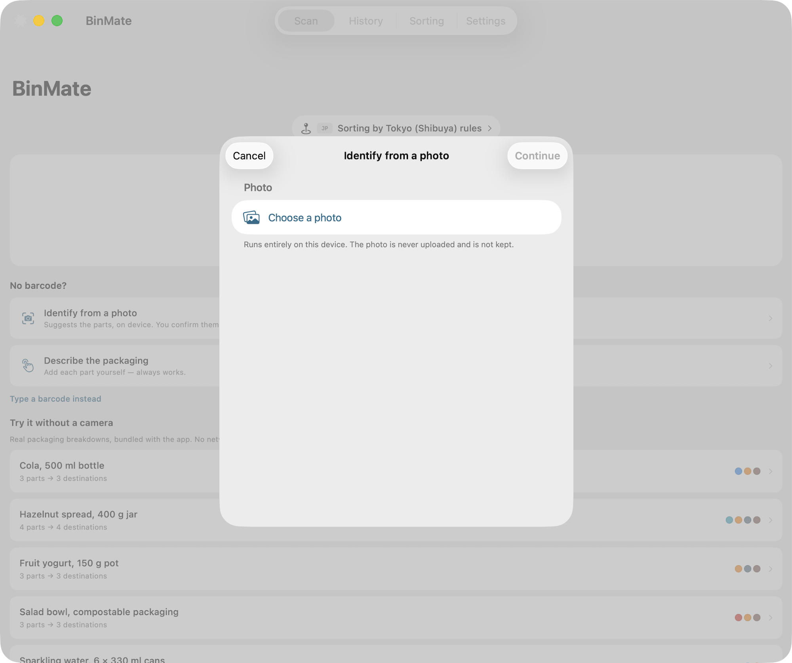 | 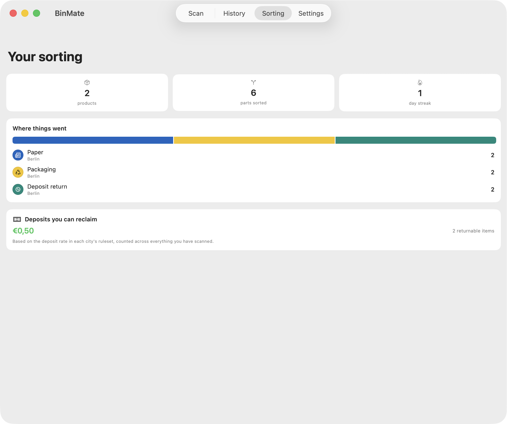 | 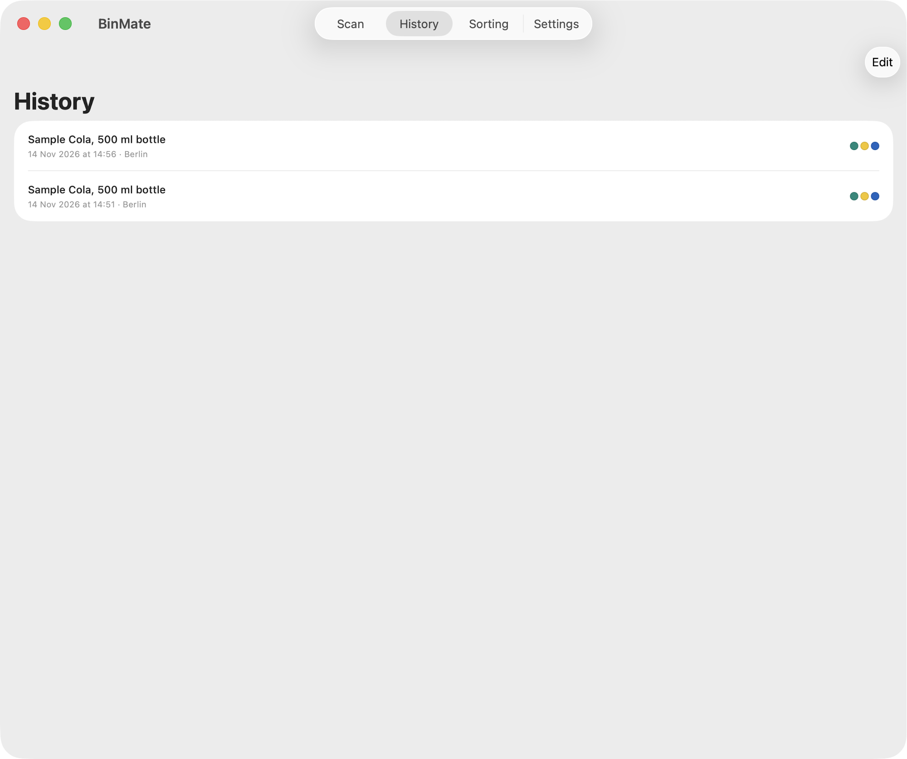 |

| The rule book, read backwards | Search, with synonyms | Things to carry somewhere |
|---|---|---|
| 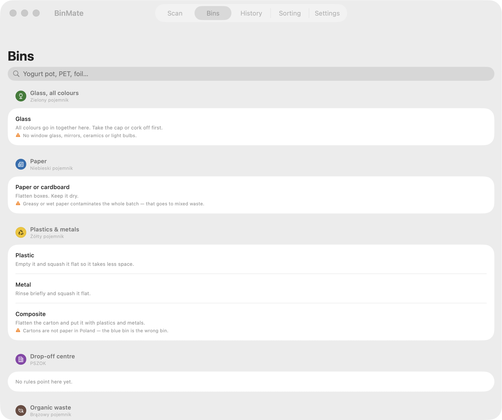 | 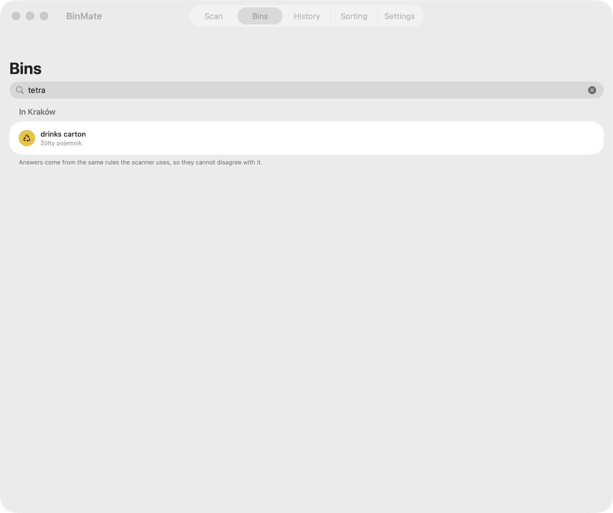 | 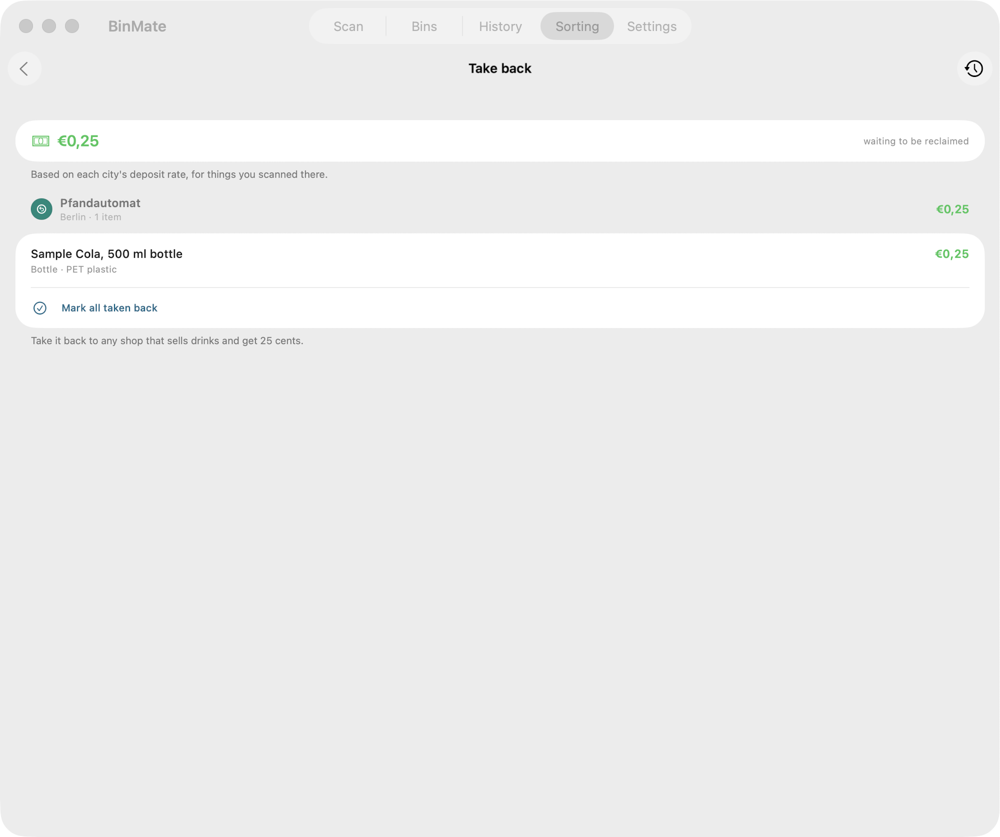 |

## The demonstration

The same 500 ml PET bottle, in five cities, resolved offline and instantly:

| | 🇵🇱 Kraków | 🇩🇪 Berlin | 🇺🇸 San Francisco | 🇯🇵 Tokyo | 🇺🇸 New York |
|---|---|---|---|---|---|
| **Bottle** (PET) | Yellow bin | **Deposit, +0.25 €** | **CRV, +0.05 $** | PET bottle collection | **Deposit, +0.05 $** |
| | *"squash it flat"* | *"**do not crush it** — the machine has to read the barcode"* | *"the blue bin also takes it — you just forfeit the nickel"* | *"take the cap **and the label** off, rinse, then crush it flat"* | *"milk and juice bottles are **not** covered — those go in the blue bin"* |
| **Cap** (PP) | Yellow bin | Gelbe Tonne | Blue bin | プラ packaging | Blue bin |
| **Label** (paper) | Blue bin | Blaue Tonne | Blue bin | 古紙 paper | **Green bin** |

Five cities, five different instructions — and Kraków and Berlin give **directly
contradictory** physical ones. No app that returns a single global answer can be right in
all five places. *(This is an assertion in the test suite, not a claim in a README.)*

A compostable PLA bowl makes the same point from the other direction:

| 🇵🇱 Kraków | 🇩🇪 Berlin | 🇺🇸 San Francisco | 🇯🇵 Tokyo | 🇺🇸 New York |
|---|---|---|---|---|
| Mixed waste | Residual waste | **Compost** | **Burned** | **Trash** |
| *"not accepted in the brown bio bin here, despite the label"* | *"rejected by the Biogut process — doesn't break down fast enough"* | *"green bin, if it carries a BPI certification mark"* | *"no household composting collection here, so it is simply burned"* | *"not accepted in New York's curbside composting, unlike in San Francisco"* |

### Same country, opposite meaning

The obvious objection to all of this is *"fine, but national rules would be close
enough"*. They would not. San Francisco and New York City are in the same country, and
their bins contradict each other:

| | 🇺🇸 San Francisco | 🇺🇸 New York City |
|---|---|---|
| **Green bin means** | **Compost** | **Paper & cardboard** |
| Cardboard box | Blue bin | **Green bin** |
| Compostable cup | Composted | **Trash** |
| Cartons | Blue bin | Blue bin, *"not with paper"* |

Someone who moves from one to the other and keeps their habits puts food waste into a
paper stream. Both of those facts are asserted in the test suite — including that the
green bin's *kind* genuinely differs between the two.

### Tokyo is the architectural proof

Japan doesn't sort by material the way Europe does — it sorts substantially by
**burnability**, and treats a PET bottle, its cap and its label as three different
resource streams requiring physical disassembly before collection.

Supporting it needed **no code change at all**. It is one more JSON file. The same
material splits by shape in both directions — a PET *bottle* is a resource, a PET *tray*
is container packaging, loose PET is burned — and the existing shape-narrowing rules
expressed all of it. That generalisation is what the rules layer was for.

---

## Why this is the hard part

Image classification of waste is a solved, commoditised problem, and it is not where
people actually go wrong. People go wrong because:

1. **They treat a product as one object.** It isn't. It's three to five materials.
2. **They assume the rule is universal.** It isn't. It's municipal, and it contradicts
   itself across borders.

So the engineering effort went into a **rules layer**, not a model. Cities are plain JSON:

```json
{
  "materials": ["en:pet-polyethylene-terephthalate"],
  "shapes": ["en:bottle"],
  "stream": "pfand",
  "instruction": "Take it back to any shop that sells drinks and get 25 cents.",
  "caution": "Do not crush it. The machine has to read the barcode and the shape."
}
```

Adding a city is a data change, not a code change.

### Resolution is hierarchical

Materials come from the Open Food Facts taxonomy, which is a tree. A rule written for
`en:plastic` automatically covers `en:rpet-recycled-polyethylene-terephthalate`, because
resolution walks the ancestry nearest-first. A city only writes a specific rule where it
genuinely differs.

Order matters more than it looks: Berlin's `PET + bottle → Pfand` rule must beat its
broader `plastic → yellow bin` rule, or the app tells a user to throw away 25 cents.
That's an asserted test, not a hope.

### The app says how confident it is, and why

Every verdict carries a match quality:

- **Specific rule for this part** — the city named this material *and* this component
- **General plastic rule** — inherited from an ancestor material
- **No specific rule — default bin** — nothing matched; the city's catch-all applies

The failure mode of every sorting app is confident nonsense. Surfacing the difference
lets a user calibrate their trust, and doubles as a to-do list for ruleset maintenance.

---

## Verification

Four suites, all runnable in seconds on any Mac, none needing a simulator:

```bash
./Tools/verify-rules.sh     # engine logic against the real city JSON
./Tools/build.sh            # compile the app
./Tools/verify-bundle.sh    # load the built .app and validate every bundled resource
./Tools/verify-guess.sh     # photo-label to packaging-part mapping
./Tools/verify-store.sh     # an older build's history still opens, intact and writable
./Tools/verify-api.sh       # live Open Food Facts calls (needs a network; not part of the build)
```

`verify-rules.sh` asserts, among other things, that shape-specific rules beat material
rules, that PET *film* does **not** get Berlin's bottle deposit, that unknown materials
fall through to the city default rather than vanishing, that contributed spellings
(`PET`, `Aluminum`, `en:Bottle`) normalise onto the taxonomy, and that a six-pack's
deposit multiplies correctly to 1.50 €.

`verify-bundle.sh` loads the actual built `.app` and checks every ruleset and sample
product is discoverable. This caught a real bug: **Xcode flattens resource folders**, so
`Resources/Rules/*.json` lands in the bundle root, not in a `Rules/` subdirectory.

`verify-store.sh` opens a history store cut from an **earlier** schema and checks every
record, every field and the ability to write afterwards. It exists because development
history once vanished during a schema change with every other suite still green — an
empty history screen is indistinguishable from a fresh install. Notably, it also refuted
the explanation I had assumed for that loss: migrating into the suspected schema
preserves everything. The guard protects the property that matters (an older build's
history must still open) rather than the mechanism I guessed at.

`verify-guess.sh` checks the photo-label mapping, including that token matching is used
rather than substring matching — otherwise *candle*, *candy*, *canyon* and *toucan* all
become drinks cans — and that every suggestion the classifier can produce resolves to a
real stream in all four cities.

---

## Architecture

```
BinMate/
  Model/        TaxonomyID, MaterialTaxonomy, PackagingComponent, CityRuleset, ScanRecord
  Engine/       RulesEngine (pure, synchronous, offline), RulesLibrary (load + validate)
  Services/     OpenFoodFactsClient, SampleProducts, ProductResolver
  UI/           SwiftUI screens
  Resources/    Rules/*.json, DemoProducts.json
Tools/          verification suites and build scripts
```

`RulesEngine` is a pure function over bundled data. That's what makes the headline
interaction possible: tapping another city re-sorts the whole product instantly, with no
request in flight and nothing to fail on stage.

**No backend, no account, no network dependency for the core feature.** All sorting rules
ship with the app. History is on-device only — a list of what someone throws away is more
revealing than it first appears, and there's no server to breach because there's no server.

### Data sourcing is layered and labelled

Lookup goes network → on-device cache → bundled samples, and the result always carries its
origin, shown in the UI. A genuine *"this barcode isn't in the database"* answer is
information and is **never** papered over with a sample product — only failures to *reach*
the service fall back. Offline mode in Settings disables the network entirely, which makes
a demo deterministic.

---

## Running it

```bash
./Tools/build.sh
open BinMate.xcodeproj    # then ⌘R
```

**No simulator runtime installed?** The app also builds and runs as a Mac Catalyst app,
which needs no runtime at all — this is how the screenshots above were captured:

```bash
./Tools/run-mac.sh
```

Live barcode scanning uses VisionKit's `DataScannerViewController`, which needs a physical
device. On the simulator the scanner sheet says so plainly and offers barcode entry and
the manual packaging picker, so **every flow is completable without a camera.**

---

## Honesty about the data

The city rulesets were **compiled by hand from each city's published public guidance** and
are not an official source. They are cited (`sourceName`, `sourceURL`) and dated
(`compiledOn`) in each file, and both are shown in the app next to every verdict, along
with a note to verify anything that matters with the local waste service.

Municipal rules change. An app that quietly serves stale rules is worse than no app.

The bundled sample products carry hand-assembled packaging breakdowns and are labelled
*"Offline sample"* everywhere they appear — they are not Open Food Facts records.

Product data comes from [Open Food Facts](https://world.openfoodfacts.org) under the Open
Database License.

---

## Current limitations

- **Five cities.** The architecture scales to any number; the bottleneck is the research
  per city, which is genuinely manual work.
- **Photo identification suggests, it does not decide.** Items with no barcode can be
  photographed, and `VNClassifyImageRequest` — Apple's general image classifier, which
  ships with the OS and needs no trained model, no dataset licence and no network —
  proposes the parts. It recognises *a bottle*, not *a PET bottle*, so every suggestion
  is presented unticked, labelled with how strong the guess is, and flagged when the
  material was assumed from the shape rather than recognised. The user confirms; the
  rules engine decides.

  Two things had to be measured rather than guessed here. The taxonomy has over a
  thousand classes, so probability mass is spread thin: on a test image the *correct*
  label came back at **0.017**, which any plausible fixed confidence threshold would have
  thrown away. The classifier is therefore filtered with Apple's calibrated
  `hasMinimumPrecision(_:forRecall:)` and falls back to the strongest raw labels, and the
  UI shows qualitative bands — *likely*, *possible*, *long shot* — because "2% match"
  would read as broken while actually being a reasonable guess.
- **Open Food Facts packaging coverage is thin, and sometimes wrong.** This is the real
  constraint on the product, and it is measurable — `./Tools/verify-api.sh` hits the live
  API and shows it:

  | Barcode | What the API returns | Reality |
  |---|---|---|
  | `5449000000996` (Coca-Cola) | 1 component: *drink can, aluminium* | can + ring pull |
  | `3017620422003` (Nutella) | 1 component: *bottle, plastic* | **glass jar**, plastic lid, foil seal, paper label |

  So the decomposition premise depends on data that is frequently absent or incorrect.
  BinMate handles this in three ways rather than hiding it: it distinguishes "no packaging
  data" from "not found", it flags single-component records on the verdict screen, and it
  lets the user **correct the parts** — which updates the verdict and the history entry in
  place. The person holding the object knows more than the database.

## Knowing where you are, honestly

The app can find your city itself — one location fix, matched against the coordinates of
the bundled rulesets. No continuous tracking: which bin you should use does not change
while you are standing at one. The coordinate never leaves the device; it is only
measured against four numbers that ship inside the app.

The interesting part is what happens when you are **not** near any of them. BinMate has
four cities. For someone in Madrid the nearest ruleset is Berlin, 1,869 km away — and
Spain sorts differently, so that is not an imprecise answer, it is a wrong one. So the
match carries a confidence, and only a close one is applied automatically:

| Where you are | Nearest ruleset | What happens |
|---|---|---|
| Kraków, Main Square | Kraków, 0 km | applied |
| Potsdam | Berlin, 27 km | applied — *"rules usually apply nearby, but check"* |
| Madrid | Berlin, 1,869 km | **offered, not applied** — *"its rules probably do not apply where you are"* |
| Nairobi | Kraków, 5,933 km | **offered, not applied** |

Nairobi matching *Kraków* rather than Berlin is the point in miniature: at that range
"nearest" carries no meaning at all, and an app that quietly assigned a ruleset would be
inventing an answer.

The distance maths is plain arithmetic, deliberately separated from CoreLocation, so the
part that decides which city you get is asserted on a desk — against real coordinates,
a known Berlin→Kraków distance, and a ruleset with no coordinates at all.

## The rule book, read backwards

The scanner answers *"where does this product go"*. The **Bins** tab answers the question
people actually ask while standing in front of a bin: *"what is allowed in this one?"*

Both read the same ruleset, so they cannot contradict each other — which is asserted,
not assumed. It also makes the data inspectable: a user who disagrees with a verdict can
see the exact rule that produced it, and anyone evaluating the app can see how much a
city actually covers rather than taking a claim on trust. Streams with no rules say
**"No rules point here yet"** instead of looking complete.

Search understands synonyms, so typing `tetra` finds the drinks carton — and in Kraków
that lands in the *yellow* bin, which is exactly the rule people get wrong.

| City | Rules | Streams covered |
|---|---|---|
| Berlin | 12 | 7 / 8 |
| Kraków | 7 | 4 / 6 |
| San Francisco | 11 | 4 / 5 |
| Tokyo (Shibuya) | 12 | 6 / 6 |
| New York City | 11 | 5 / 6 |

## From knowing to doing

Most packaging just goes in a bin. Two kinds do not: **deposit items**, which are worth
money, and **drop-off items**, which the kerbside collection refuses. The app knew about
both and did nothing useful with them — it printed a reclaimable total and left the user
to remember which bottles it meant.

The **Take back** list turns history into a trip you can tick off, grouped by destination
and city, using each city's own wording rather than a second set of instructions:

```
€0.25 waiting to be reclaimed

  Pfandautomat · Berlin · 1 item                          €0.25
    Sample Cola, 500 ml bottle — Bottle · PET plastic     €0.25
  "Take it back to any shop that sells drinks and get 25 cents."
```

Each record is re-resolved against the city it was *scanned* in, not the city currently
selected: a bottle scanned in Berlin is worth 25 cents at a German machine no matter
where its owner is standing today. Euros and dollars are totalled separately, and a city
with no deposit scheme produces nothing rather than a zero.

## Home screen widget

A glance at what the bins mean where you are, in small and medium sizes. It reads the
bundled rulesets and the selected city, and nothing else — deliberately **no SwiftData**:
a widget has no business reading a list of what someone throws away, and keeping the
store out of reach means the widget can never endanger it.

It lists only *kerbside* bins. A deposit machine is a destination, not a bin, and showing
"Pfandautomat" beside "Gelbe Tonne" would imply one is standing in the kitchen. That
predicate lives in `Shared` and is asserted for every city, along with the requirement
that the catch-all bin always appears — a bin list that omits "everything else" looks
more decisive than the rules actually are.

**The city is configured on the widget**, not inherited from the app — long-press, pick
a city. That design came out of a constraint rather than a preference: following the
app's choice needs the `group.app.binmate` App Group, and App Group entitlements require
a provisioning profile, so an unsigned or ad-hoc build gets none. `codesign -d
--entitlements` returns an empty dict for both. Rather than ship a widget that silently
showed the wrong place, the widget carries its own setting, which works in every build —
and turns out to be better anyway, since someone who travels can keep one widget per
city. The app's choice is still read as the *starting* value where the entitlement is
available.

The picker is a `WidgetConfigurationIntent` backed by the same rulesets the app loads, so
the list it offers can never drift from what the app can actually sort against. That is
asserted: every bundled city appears, a stored id round-trips back to its city, an id
from a ruleset that no longer ships drops out instead of resurrecting as a blank entry,
and a freshly added widget lands on a city that really loaded.

Writing that test immediately found a gap — `CityEntityQuery` read `Bundle.main` with no
seam, which is right inside the extension and empty in a host harness. It now takes an
injectable library like every other loader in the project.

What is verified: the extension builds, embeds at `PlugIns/BinMateWidget.appex` with its
own copy of the rules, declares `com.apple.widgetkit-extension`, exports its intent
metadata, and is registered by the system — `pluginkit -mv` inside the simulator lists
`app.binmate.BinMate.widget`. Its rendered appearance on a home screen has not been seen.

**Tapping it works**, which was not true when it was first written. The widget's
description said "tap to scan" while it had no tap target at all, and the Shortcuts
action said it opened the app "ready to scan a barcode" while only launching it. Two
descriptions that were not yet behaviour. Both now land in the same place:

```
xcrun simctl openurl … "binmate://scan"
→ app launches from cold, lands on the Scan tab, opens the scanner
```

The two use different routes because they are in different situations. A widget runs in
its own process and can only hand back a URL, so `binmate://scan` is registered in the
app's `Info.plist`. The Shortcuts action, declared by the app with no separate intents
extension, runs *inside the app's process* — so it leaves a request in the app's own
defaults, no App Group required. Both are asserted, including that a consumed request
never fires twice and that `binmate://settings`, `https://binmate.app/scan` and
`otherapp://scan` are all ignored.

## Siri and Shortcuts

*"Hey Siri, which bin in BinMate?"* — answered without opening the app, because the rules
are bundled and resolving them is a pure function. There is nothing to fetch.

```
Berlin:  A plastic bottle goes to deposit return — the Pfandautomat — in Berlin.
         Take it back to any shop that sells drinks and get 25 cents. Do not crush
         it. The machine has to read the barcode and the shape. That is just the
         main part — scan the barcode to sort the rest of the packaging.

Kraków:  A cardboard box goes in paper — the Niebieski pojemnik — in Kraków.
         Flatten boxes. Keep it dry. Greasy or wet paper contaminates the whole
         batch — that goes to mixed waste.

Tokyo:   A compostable cup goes in burnable waste — the 可燃ごみ — in Tokyo
         (Shibuya). There is no household composting collection here, so
         compostable plastic is simply burned.
```

Two details that only showed up once the sentences were read aloud:

- **You go *to* a deposit machine, but *in* a bin.** The phrasing switches on the stream
  kind.
- **The refund must be said once.** Berlin's own instruction already ends "…and get 25
  cents", so the generated "worth €0.25 back" sentence is suppressed when the city's
  instruction already mentions money. Hearing the amount twice in one breath sounds
  like a bug.

And a structural one: for anything that is really several parts — a bottle, a jar, a
yogurt pot — the answer ends by saying so. Siri confidently naming one bin for a yogurt
pot would be the exact mistake this app exists to correct.

The item list and the lookup are plain Foundation types, with a thin `AppIntents` wrapper
on top, so the part that can actually be wrong is covered by the test suite. Siri's
display names are a compile-time literal (the metadata processor rejects anything
computed), so `verify-bundle.sh` reads them back out of the source and fails if they ever
drift from the app's own names.

## Roadmap

- Community ruleset contributions with the match-quality gaps as the backlog
- Geocoded city selection instead of a manual picker
- A Core ML classifier trained on waste imagery, to replace the general-purpose Vision
  classifier for barcode-less items
